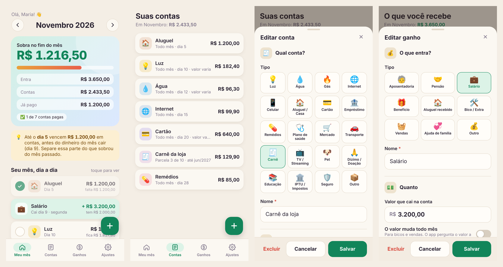
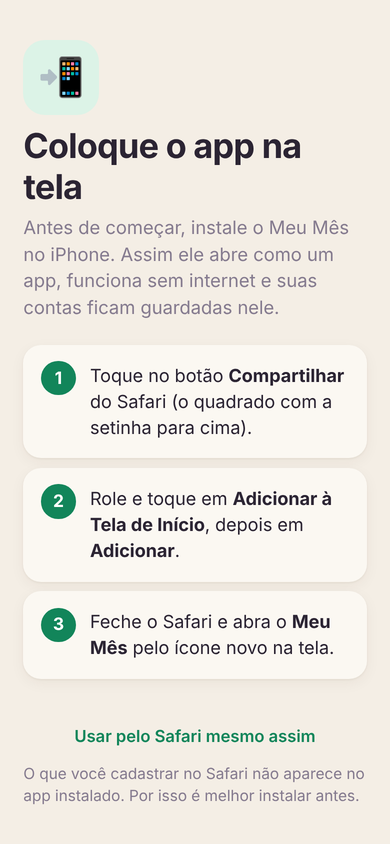
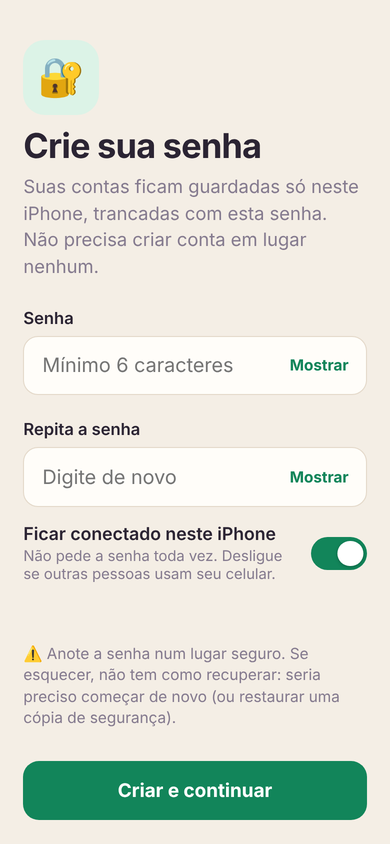
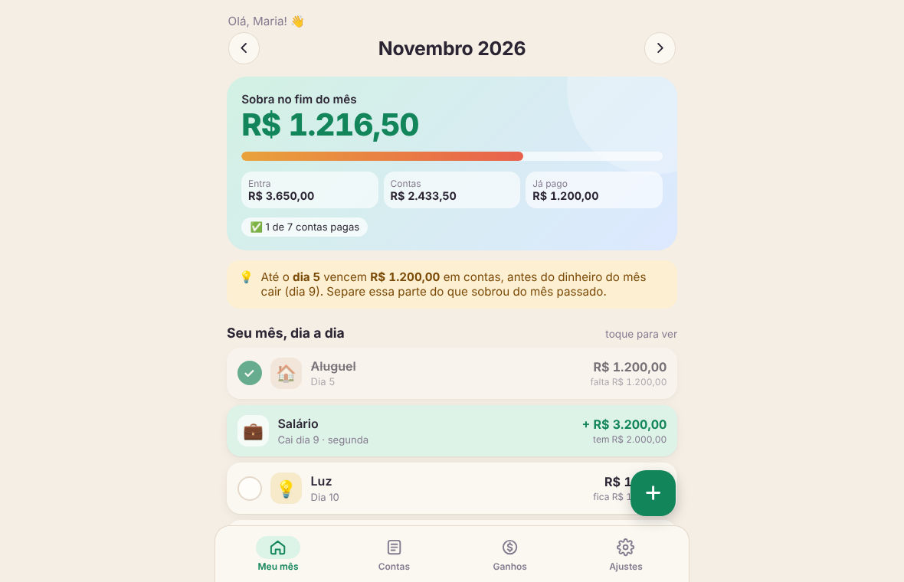

<div align="center">


# Meu Mês

**Contas, ganhos e quanto sobra no fim do mês, num app simples feito para qualquer pessoa usar.**

Android · iPhone · iPad · Mac · Windows · navegador

[Baixar](https://github.com/pedroplatenik/meu-mes/releases/latest) · [Usar no navegador](https://meu-mes-financa.netlify.app) · [Como funciona](#como-funciona) · [Formato dos dados](docs/formato-dos-dados.md)



<sub>Telas com dados de exemplo.</sub>

</div>

---

## O que é

O Meu Mês nasceu de uma necessidade simples: saber, antes do mês acabar, **quanto dinheiro vai sobrar** e **o que vence em cada dia**. Você cadastra o que recebe e as contas que paga, e o app monta o mês dia a dia, mostrando o saldo depois de cada entrada e de cada conta.

Ele foi pensado para pessoas de todas as idades: letras grandes (com três tamanhos), cores escolhidas pela pessoa, botões grandes e nenhum termo técnico.

## Como funciona

### O mês, dia a dia
- **Sobra no fim do mês** em destaque, com quanto entra, quanto sai e quanto já foi pago.
- Linha do tempo do mês com o **saldo depois de cada movimento** ("fica R$ …").
- Avisos quando **faltar dinheiro** ou quando uma conta **vence antes do salário cair**.
- Gráfico de **para onde vai o dinheiro**.
- Marque uma conta como **paga** com um toque.
- Navegue entre os meses com as setas.

### Contas
- 20 categorias prontas (luz, água, cartão, carnê, aluguel, remédios, plano de saúde…).
- **Todo mês**, **parcelado** (parcela 3 de 10, com a data da última) ou **uma vez só**.
- Contas com **valor que muda todo mês** (luz, água, cartão): o app pergunta o valor de cada mês e sugere o do mês anterior.
- Conta **sem data definida** ("ainda não sei").
- Ao mudar um valor fixo, você escolhe: **daqui em diante** ou **só neste mês**.
- Ao apagar: **tirar só deste mês**, **parar a partir de agora** ou **apagar de todos os meses**.

### Ganhos
- Salário, aposentadoria, pensão, benefício, aluguel recebido, bico, vendas, ajuda de família.
- Data do pagamento em **dia fixo**, **N-ésimo dia útil** (ex.: 5º dia útil) ou **último dia útil**. O app considera **feriados nacionais** e a **Sexta-feira Santa**, com a opção de contar ou não o sábado.

### Lembretes, resumo e cópias
- **Android**: notificações antes de cada conta vencer e no dia em que o dinheiro cai, com horário à escolha.
- **iPhone, Mac e Windows**: lembrete no Google Agenda com um toque, repetindo todo mês (e parando sozinho na última parcela).
- **Resumo do mês** pronto para mandar no WhatsApp.
- **Cópia de segurança** num arquivo que abre em qualquer versão do app, do Android ao Windows.

## Privacidade

- **Não tem cadastro, conta nem servidor.** Tudo fica guardado no próprio aparelho.
- Na versão do navegador (iPhone, iPad e Mac), os dados ficam **trancados com uma senha** criada pela pessoa, com criptografia AES-GCM de 256 bits e chave derivada por PBKDF2-SHA-256 (310.000 iterações). Ninguém mais consegue abrir, nem o autor.
- O app não usa internet para funcionar e não envia nada para lugar nenhum.

> Como os dados ficam só no aparelho, faça uma **cópia de segurança** de vez em quando (Ajustes → Salvar cópia de segurança). Se a senha for esquecida, não existe forma de recuperá-la.

## Instalar

| Aparelho | Como instalar |
|---|---|
| **Android** | Baixe o `MeuMes.apk` em [Releases](https://github.com/pedroplatenik/meu-mes/releases/latest), abra e permita instalar de fontes desconhecidas. Android 7 ou mais novo. |
| **iPhone / iPad** | Abra [meu-mes-financa.netlify.app](https://meu-mes-financa.netlify.app) no **Safari** → Compartilhar → **Adicionar à Tela de Início**. |
| **Mac** | Abra o link no **Safari** → menu Arquivo → **Adicionar ao Dock** (macOS 14 Sonoma ou mais novo). No Chrome, use o botão de instalar da barra de endereço. |
| **Windows** | Baixe o `MeuMes-Windows.zip` em [Releases](https://github.com/pedroplatenik/meu-mes/releases/latest), descompacte e abra `MeuMes.exe`. Windows 10 ou 11. |

<details>
<summary><b>Mais imagens</b></summary>
<br>

| Instalar no iPhone | Criar a senha | No computador |
|---|---|---|
|  |  |  |

</details>

## Estrutura do projeto

Todas as versões usam a **mesma interface**, escrita em HTML, CSS e JavaScript puros, sem bibliotecas. Muda só a "casca" de cada plataforma, que guarda os dados e faz o que é nativo dela.

```
meu-mes/
├── web/        iPhone, iPad, Mac e navegador (PWA: funciona sem internet, dados cifrados com senha)
├── android/    App Android nativo (WebView) com notificações e lembretes
│   ├── assets/index.html
│   └── src/app/meumes/casa/   MainActivity.java (ponte com o app) e Lembretes.java (alarmes)
├── windows/    Programa para Windows (WinForms + WebView2)
│   ├── MeuMes.cs
│   └── index.html
└── docs/       Formato dos dados e imagens
```

| Versão | Onde os dados ficam |
|---|---|
| Android | Arquivo interno do app, com cópia automática da versão anterior |
| Windows | `Documentos\Meu Mês\meus-dados.json`, com cópia automática da versão anterior |
| iPhone, iPad, Mac | Armazenamento do navegador no próprio aparelho, cifrado com a senha |

O formato do arquivo é o mesmo em todas, por isso uma cópia feita no celular abre no computador e vice-versa. Veja [docs/formato-dos-dados.md](docs/formato-dos-dados.md).

## Compilar

<details>
<summary><b>Android</b></summary>

Precisa do Android SDK (plataforma `android-23` e `build-tools 29`) e do JDK. O projeto não usa Gradle.

```bash
export MEUMES_SENHA_CHAVE='uma-senha-forte'
./android/build.sh          # gera android/build/MeuMes.apk
```
Na primeira vez, o script cria uma chave de assinatura nova em `android/chave/`, que não vai para o repositório.
</details>

<details>
<summary><b>Windows</b></summary>

Compila em Linux ou Windows com o `mcs` do Mono. As DLLs do WebView2 (redistribuíveis da Microsoft) são baixadas pelo próprio script.

```bash
./windows/build.sh          # gera windows/build/MeuMes.exe
```
O computador precisa do Microsoft Edge WebView2, que já vem no Windows 11 e na maioria dos Windows 10.
</details>

<details>
<summary><b>Web (iPhone, iPad, Mac)</b></summary>

A pasta `web/` é um site estático. Para publicar, basta enviá-la para qualquer hospedagem de arquivos estáticos (Netlify, GitHub Pages…). O arquivo `_headers` define a política de segurança no Netlify.
</details>

## Autor

Criado por **Pedro Platenik**.

## Licença

© 2026 Pedro Platenik. **Todos os direitos reservados.** O código está público só para consulta. Veja [LICENSE](LICENSE).
